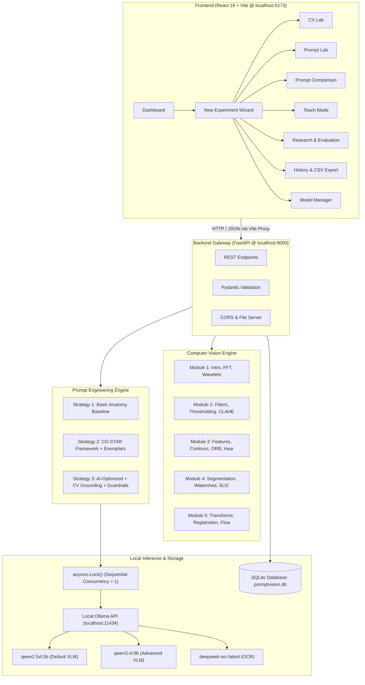

# System Architecture — PromptVision

## 1. High-Level Component Topology

PromptVision is built as a modular client-server architecture consisting of four decoupled layers:
1. **Frontend Presentation Layer** (React 19 + Vite + Recharts + Lucide Icons)
2. **Backend Application & Service Layer** (FastAPI + Pydantic + Uvicorn)
3. **Computer Vision & Processing Engine** (OpenCV + NumPy + scikit-image + SciPy + PyWavelets)
4. **Local Multimodal AI & Persistence Layer** (Local Ollama Engine + SQLite3)



---

## 2. Hardware Resource Management (Intel Core i5-1235U & 16GB RAM)

### 2.1 The Concurrency Lock (`asyncio.Lock`)
Local multimodal models with billions of parameters (e.g. Qwen2.5-VL 3B: ~3.2GB weights in RAM) require substantial memory bandwidth during CPU matrix multiplications. Attempting parallel execution of three prompt strategies simultaneously would cause severe thrashing and out-of-memory errors on a 16GB system.

PromptVision solves this by implementing an asynchronous execution lock in `backend/app/llm/ollama_service.py`:
- All requests acquire `_inference_lock`.
- Strategy 1 executes $\rightarrow$ tokens/latency recorded $\rightarrow$ Strategy 2 executes $\rightarrow$ Strategy 3 executes.
- Peak memory usage never exceeds that of a single active model instance.

### 2.2 Memory Recovery Endpoint
The Model Manager provides an explicit memory deallocation endpoint:
```http
POST /api/models/unload
Content-Type: application/json

{"model": "qwen2.5vl:3b"}
```
This sends `keep_alive: 0` to Ollama, causing it to immediately release weights from system RAM back to Windows.

---

## 3. Database Schema (`promptvision.db`)

PromptVision uses a lightweight, self-contained SQLite3 relational schema initialized automatically at startup:

### Table: `experiments`
| Column | Type | Description |
|---|---|---|
| `id` | TEXT PRIMARY KEY | UUID string identifier |
| `created_at` | TEXT | ISO 8601 UTC timestamp |
| `title` | TEXT | User or system-generated run title |
| `image_id` | TEXT | Reference to uploaded source file |
| `image_width`, `height`, `channels` | INTEGER | Dimensional metadata |
| `selected_objective` | TEXT | Summarise, Analyse, Evaluate, Explain, Teach |
| `cv_operations` | TEXT (JSON) | Array of selected CV ops and parameters |
| `cv_metadata` | TEXT (JSON) | Extracted mathematical visual metadata |
| `selected_model` | TEXT | Model name (e.g. `qwen2.5vl:3b`) |
| `preferences` | TEXT (JSON) | Audience, tone, format, length, few-shot setting |
| `prompts` | TEXT (JSON) | Synthesized prompts (`basic`, `costar`, `ai_optimized`) |
| `responses` | TEXT (JSON) | Model response text for each strategy |
| `metrics` | TEXT (JSON) | Provider token metrics (`prompt_eval_count`, `eval_count`, `latency_sec`) |
| `ratings` | TEXT (JSON) | Human and heuristic evaluation ratings |

### Table: `teach_sessions`
Stores educational quizzes, user submitted answers, score percentages, diagnostic weak concepts, and understanding levels (*Beginner, Developing, Good, Strong*).
